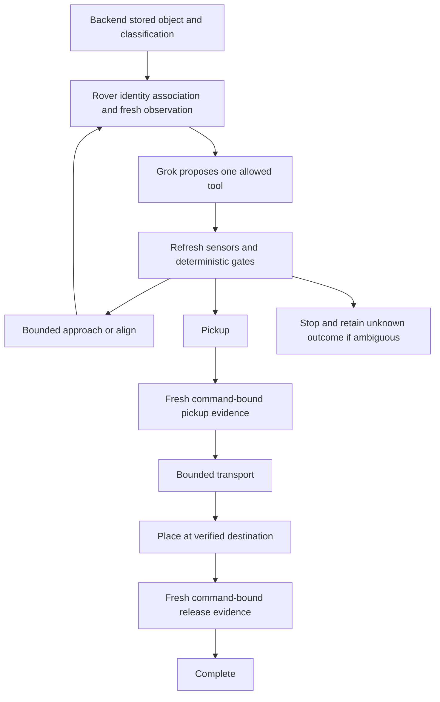

# Recovery tools v1 — draft adapter proposal

This is a new **in-process simulator interface**, not a replacement for existing
robot HTTP contracts or an agreed physical API. Types live in
`integration/recovery/types.py`. No new routes exist. P3 remains the only mission
command caller; P4 remains sole DJI SDK owner. P3/P4 must agree a later adapter
and durable authority before physical wiring.

`Mission`: `mission_id`, target (`object_id`, `revision`, cached `classification`,
backend `dispatch_eligible`), `destination_id`. CLI supplies a labelled fixture.
`targets.read_target` supports authenticated `/api/snapshot` without direct DB
access. A snapshot is data, not mission authority: physical integration still
needs P3's durable reservation, fresh mapping/route and pickup authorization.

Policy returns only `ToolCall`: `action` (approach, align, pickup, transport,
place, stop), `object_id`, `destination_id`. Extra fields, unknown tools, multiple
calls, ID changes and phase skipping are rejected. A matching label is not
identity evidence. Association must reference the same DB object and revision;
unknown or ambiguous association stops. No per-frame reclassification is needed.

| Adapter method | Semantics |
| --- | --- |
| `begin(mission_id)` | Atomically reserve one mission; deny replay/concurrency. Fixture retains reservation for its lifetime; physical backend must do this durably. |
| `observe(mission)` | Strict `Observation` from actual perception/sensors, never model-generated flags. |
| `execute(command)` | One attempt of a bounded action; receipt ACKNOWLEDGED, REJECTED or UNKNOWN. No retry. |
| `stop(mission_id)` | STOPPED only after local confirmation; otherwise UNKNOWN. No implicit rearm/resume. |

Observation requires camera/session/frame identity, capture and telemetry UTC
times (age 0..0.5s), matched object ID/revision, explicit identity evidence,
stationary/living-obstacle flags and safety READY. Frames strictly increase;
camera/session changes require reassociation outside this run. After an action,
`after_command_id` must match; frame/telemetry capture cannot predate issue time
(ties allowed at sensor resolution). Clock synchronization and receipt freshness
need validation before physical wiring.

Near/aligned/holding/at-destination/released flags are trusted adapter outputs.
Pickup requires near+aligned, stationary target and ready safety state.
Transport/place require continuing held-object evidence. `pickup_evidence_id`
with matching `pickup_command_id` verifies pickup. `placement_evidence_id` with
matching `placement_command_id`, destination, released and not-holding verifies
placement. Physical evidence must be independent observations, not ACK or an arm
command. A graspability estimate cannot authorize dispatch.

Command contains deterministic ID (mission+step), mission/object/revision,
destination, action, source frame, identity evidence, expiry `now+0.3s` and
`max_duration_ms <=300`. These are **fixture orchestration limits**, not measured
robot performance or the existing pickup HTTP body's 3s TTL. A physical arm macro
may need longer: agree a separate bounded macro/status contract with P4 rather
than extending drive leases while waiting for Grok. Mapping and deterministic
robot control supply calibrated routes, speeds, transforms, obstacle checks and
local watchdog. Grok supplies none of those values.

Lost ACK/exception after sending means UNKNOWN, retained even if stop later
confirms. Keep the rover slot and reconcile by stable command ID; never recreate
or replay on restart. Simulator reservation is memory-only. Canonical hold/pickup
arbitration and rearm/stop semantics remain in force.

Returned graph events are diagnostics, not dashboard SSE. P3 must persist
stage/evidence/error changes and emit its existing backend stream; P1 can then
display them. No DB migration or automatic robot dispatch is added here.
Physical execution has no implementation or enable switch.
