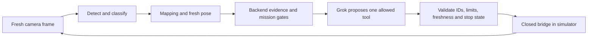

# Grok-to-rover integration review — 2026-11-04

Reviewed the local Grok handoffs and vision changes, current GitHub board,
current main backend source, and robot PR #17 at
`dd347b442650712e458c07a16822a2b54e102051`. This is a review checkpoint,
not authorization for physical movement or pickup.

## Current findings

- PR #17 is published and open/unmerged. The older statement that the branch
  does not exist is stale. Simulator is the default; physical pickup remains
  simulated-only. The camera URL last reported by P4 is
  `http://192.168.5.194:8004`, camera-only. Reachability is not reverified here.
- The handoff's claim that merged vision ingestion is only in memory is stale:
  PR #16 is merged and current main includes the durable vision projection path.
  This checkout's backend is older; actual persistence depends on deploying
  current code with its scoped database configuration. No shared DB was tested.
- The measured 100 mm jaw opening, zero closed gap, measured reach/settle/backlash
  values in vision/graspability.py match the robot owner's report in board
  comment 6639012926. The 15 mm size screen is correctly distinguished from the
  physical gap. Payload cap, published grip/travel, unknown object mass/size,
  and pickupVerified:false remain explicit. These are not a successful pickup test.
- Current backend/grok_intent.py accepts inspect_objects, explain_alert and
  propose_collect. It does not implement a model-to-motion decision loop.

## PR #17 must be fixed before control integration

1. **Physical adapter startup:** bridge.py passes allow_motion to DJIOutput,
   which accepts max_speed instead, then uses a nonexistent output.write
   rather than its callable interface. The bench adapter also rejects yaw and
   caps translation at 0.05 m/s, unlike the advertised bridge limits.
2. **Watchdog and telemetry lifecycle:** simulator startup has no running
   watchdog; physical startup constructs one without starting it. Physical
   telemetry/heartbeat wiring is absent. A fake-output offline probe left
   nonzero output after its deadline when no new request arrived.
3. **Premature stop/rearm success:** command state becomes STOPPED while the
   controller remains UNKNOWN. Command rearm returns success without confirmed
   stop and can suppress a controller error. Backend reconciliation could treat
   a still-unconfirmed command as terminal.
4. **Pickup during pending stop:** manual release clears the lease while stop
   confirmation is UNKNOWN; pickup checks the lease but then accepts PICKING.
   UNKNOWN must continue excluding pickup.

The canonical hold race is correct: hold winning returns 409 HELD on pickup.
The handoff phrase "pickup after hold" must not be implemented by bypassing that
latch. Agree the pre-pickup stationary state separately from an active hold.

Owner fix request, with source references and tests:
https://github.com/AlanDD13/Big_AI_hackathon/issues/1#issuecomment-6640370423.
No robot/** changes, merges, SDK sessions or physical calls were made by this review.

## Validation and local fixes

- Corrected the vision remote-offload test's obsolete mock: the client now
  passes certificate verification, and its mocked URL now uses HTTPS port 8443.
- Preserved the pending camera STALE_FRAME handling and changed byte-limit
  checks to reject an oversized chunk before copying it into the accumulation
  buffer. Error polls retain frame identity; they never refresh stale imagery.
- Vision tests: 143 pass with the one real loopback-server test deselected.
  The complete run reaches the same 143 passes but the loopback test cannot bind
  its localhost socket in this sandbox. It is not a verified HTTP integration pass.
- PR #17 reviewer reports 37 safety, 7 telemetry and 2 non-HTTP bridge tests
  passing. The fake-only probes reproduce the watchdog/stop/rearm/pickup bugs.
  HTTP lifecycle testing was sandbox-blocked; physical behavior was not tested.
- A separate earlier live Grok API request was blocked when automatic approval
  review hit a usage limit. This review did not retry that action or send model keys.

## Required sequence after owner fixes

Alan clarified the intended retrieval flow: detect/reidentify the target from
the rover camera, match it to an existing DB object, and reuse that object's
stored semantic classification. Do not reclassify every frame. If identity is
ambiguous, the object is new, or the stored evidence is unsuitable, stop and
resolve/reclassify rather than transferring a label from a similar object.
Fresh observations still govern living/carried/moving exclusions, location,
reachability and grasp confirmation; a database label is not current physical state.

LangGraph can orchestrate closed HTTP tool wrappers against the simulator while
P4 fixes its bridge. Physical drive and manipulation remain separately enabled
capabilities. Transporting an object also requires a reviewed placement/drop
operation and pickup-success confirmation; these are not established by PR #17.

First prove the complete loop in the simulator, including expiry, refusal,
duplicate command, lost acknowledgement and restart. Before physical integration,
P4 must publish the active mode/capabilities and a reviewed bridge head with
working watchdog, telemetry and truthful stop confirmation. Grok never receives
the SDK. Pickup stays separately disabled until the robot owner enables and
validates it; a model's LIKELY estimate cannot replace those checks.
